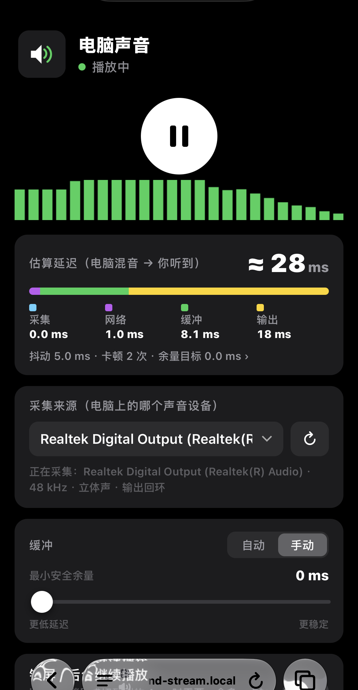
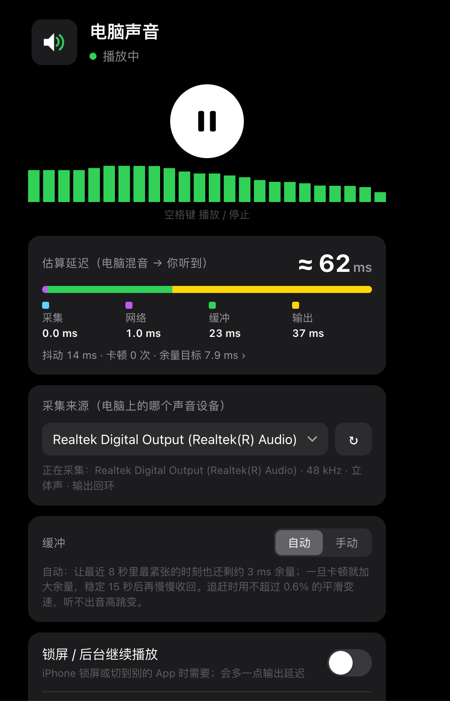
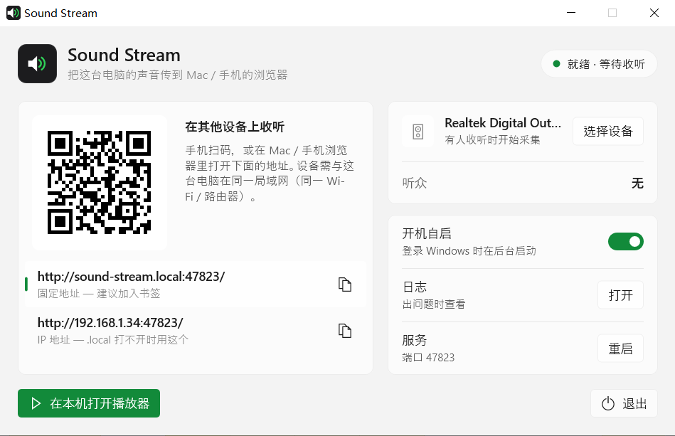

# 🔊 Sound Stream（立体声 · 低延迟 · 中文版）

> **这是一个 fork。** 原项目：[resuvelt/sound-stream-for-mobile](https://github.com/resuvelt/sound-stream-for-mobile)（MIT 协议），
> 感谢原作者。本仓库在原版基础上做了立体声、低延迟、设备选择、延迟估算和中文界面等改动，详见下文；
> 原版英文说明保留在后半部分。

**Windows 上双击一个 exe，Mac / iPhone / 安卓的浏览器里就能听电脑的声音。** 不用装 App，同一局域网（Wi-Fi）就行。

👉 **下载：[Releases](https://github.com/Urutoramarin2000/sound-stream-for-mobile/releases/latest) 里的 `sound-stream.exe`**（Windows 10/11 x64，单文件）

<p align="center">
  
  &nbsp;
  
</p>
<p align="center"></p>

## 用法

1. Windows 上运行 `sound-stream.exe`（SmartScreen 提示时点「更多信息 → 仍要运行」，防火墙允许「专用网络」）。
2. Mac / 手机连同一个 Wi-Fi，扫窗口里的二维码，或浏览器打开 **`http://sound-stream.local:47823/`**（打不开就用窗口里的 IP 地址）。
3. 点播放。需要的话在网页或电脑窗口里「选择设备」。

小技巧：
- **只想在 Mac / 手机上出声、电脑静音**：装一个虚拟声卡（如 VB-CABLE）设为 Windows 默认输出，保持「跟随默认输出」即可。
- **延迟主要看 Wi-Fi 抖动**：电脑插网线、手机离路由器近一点；Mac 上可以 `sudo ifconfig awdl0 down`（会暂停 AirDrop）。
- **iPhone 锁屏继续听**：打开「锁屏 / 后台继续播放」（会多一点输出延迟）。
- **别用蓝牙耳机**：通常额外增加 150 ms 以上。

## 相比原版的改动

| | 原版 | 本 fork |
|---|---|---|
| 声道 | 单声道（左右混在一起） | **立体声**（5.1/7.1 的中置按 -3 dB 混入左右） |
| 发包 | 攒满 10 ms 帧再发 | 每次 WASAPI 唤醒立即发；采集线程 MMCSS「Pro Audio」优先级 |
| 播放排程 | 每块用 ±2% playbackRate 追赶（音高会跳） | 样本级首尾相接；≤0.6% 的平滑重采样追赶时钟漂移 |
| 缓冲 | 固定滑块 | **自动自适应**：最近 8 秒最紧张时刻仍留约 3 ms；卡顿后加大、稳定后收回；积压直接裁掉；也可手动 |
| 输出路径 | 总是经 `<audio>`（为了 iOS 后台） | 默认直连 Web Audio 输出；锁屏模式改为开关 |
| 采集设备 | 只能跟随默认输出 | **可选**：默认输出 / 任意输出设备（回环）/ 任意输入设备（麦克风、线路输入、虚拟声卡）；窗口、托盘、网页都能选，设备拔插自动回退 |
| 延迟显示 | 只有本地缓冲 | **估算总延迟** = 采集（PC 实测）+ 网络（ping/2）+ 缓冲 + 浏览器输出，另显示抖动、卡顿次数 |
| 播放端开销 | 频谱跟随屏幕刷新率（120 Hz 屏就是 120 帧） | 频谱 30 帧/秒，可关 |
| 其他 | 俄语界面 | 中文界面；iOS 17+ 静音开关不再静掉声音；Mac 空格键播放/停止 |

协议与原版不兼容（音频包是立体声 + 12 字节包头），但网页内嵌在 exe 里，两者总是配套的。

---

## Original README (upstream)

Listen to your Windows PC's audio on your phone, right in the browser. No app to install.

A single `sound-stream.exe` captures everything your speakers play (WASAPI loopback) and
streams it over Wi-Fi to any iPhone or Android browser. It has a small window with a QR code
for your phone and lives in the system tray.

## Run

1. Download `sound-stream.exe` from the latest release (Releases).
2. Run it. A window opens with a QR code and the phone address.
3. On your phone (same Wi-Fi), scan the QR code or open **`http://sound-stream.local:47823/`**, then tap play.

It works on Windows 10/11 x64 with nothing to install.

- **SmartScreen** may warn about an unknown publisher. Click **More info → Run anyway**.
- **Windows Firewall** may ask on first launch. Allow it for private networks.

## Build from source

```bash
cargo build --release
```

This needs [Rust](https://rustup.rs) 1.85+ with the MSVC toolchain and gives you
`target\release\sound-stream.exe`.

To publish a release, push an annotated version tag (`git tag -a 2.1 && git push origin 2.1`).
GitHub Actions then builds the exe and attaches it to the release, using the tag message as the
release notes.

## Window and tray

The interface is in Russian and follows the Windows light or dark theme.

- **Window:** a QR code for the phone, the permanent address and fallback IP addresses (click
  one to show it in the QR code, or copy it), the captured device and listener count, start with
  Windows, the log, restart and exit. Closing the window keeps the server running in the tray.
- **Tray icon:** a click opens a compact panel with the status, addresses, the player on this
  PC, start with Windows, the log, restart and exit. A double-click opens the window.
- Started with Windows, it shows only the tray icon. Running the exe again opens the window.

## Notes

- Capture starts with the first listener, stops when everyone leaves, and follows changes of the default output device.
- `sound-stream.local` is announced via mDNS, so the bookmark survives DHCP IP changes. If it doesn't resolve, check that your router has client/AP isolation turned off, or use the IP address from the window.
- Optional environment variables: `PORT` (default `47823`) and `MDNS_NAME` (default `sound-stream`).
- Log: `%LOCALAPPDATA%\sound-stream\server.log`.

## License

MIT
